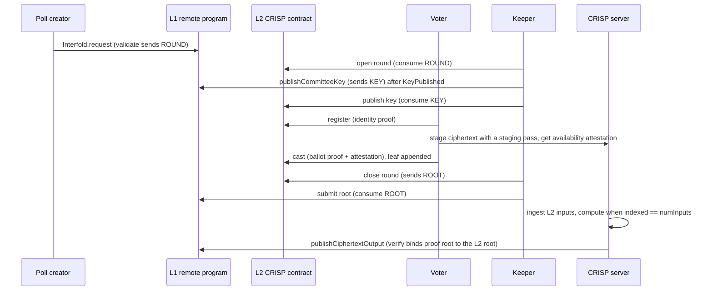

# CRISP extensions

CRISP rounds whose voters live on another chain (an L2) while Interfold, the committee and the
compute stay on Ethereum. The voter-facing chain collects registrations and ballots and builds the
input tree; Ethereum only receives the tree root when the input window closes. The poll creator
still makes a single L1 transaction (`Interfold.request`).

## Registration and nationality

Voters register on the L2: the voter proves their identity to the L2 contract, which inserts the slot into the
census. A poll can require a minimum age and a nationality in, or not in, a list of countries; the L2 contract
is given only the list's commitment, so the circuit proves a match without a list on the L2. See `aztec/README.md`
("Registration and nationality").

## Layout

| Path | Role |
| --- | --- |
| `core/contracts` | `CRISPRemoteProgram`: chain-agnostic L1 E3 program; `CRISPRemoteMessages`: ROUND/KEY/ROOT layouts. |
| `core/remote-input` | Rust crate `crisp-remote-input`: the server seam (`RemoteInputSource`, `InputRootSubmitted`, gating, availability attester, staging pass statement). |
| `core/circuits/staging_pass` | Noir circuit of the staging pass: an anonymous, rate-limited proof that the sender holds the key of some slot of the round's census, required to stage a ciphertext with the server (see `core/README.md`). |
| `aztec/` | Reference extension for Aztec v6 (see `aztec/README.md`). |

## Adding an L2

A new chain adds a sibling `extensions/<l2>/` with:

1. **L1 adapter** extending `CRISPRemoteProgram` (see `core/README.md`): deliver ROUND/KEY through
   the chain's L1→L2 bridge, authenticate ROOT through its L2→L1 bridge and call `_acceptInputRoot`.
2. **L2 contract** that reproduces `CRISPProgram`'s input tree byte for byte (leaf formula, zk-kit
   lazy IMT, circom Poseidon, dynamic root depth), verifies the three base proofs of the CRISP ballot (no fold) and the server's
   availability attestation, enforces the slot parent chain, window, limit and replay rules, and
   emits inputs, and the census root after each registration, in a form the server can index (the
   staging pass names a census root, which the server checks against them).
3. **Server ingest** crate implementing `crisp_remote_input::RemoteInputSource`
   (`fetch_inputs(e3_id, after)`, `census_roots(e3_id, after)`, `latest_timestamp()`) plus a `ProgramKind`
   variant. The server then
   attests availability with the shared `AvailabilityAttester`, ingests inputs into the same round
   record the L1 `InputCommitted` handler fills, computes once `indexed == numInputs`, and reuses
   `run_compute`, `stage_output` and `publishCiphertextOutput` unchanged.
4. **SDK and keeper** for voter transactions and the permissionless relays.

The OpenVM guest, program server and CRISP circuits are shared by every extension and must not
change for one chain.
